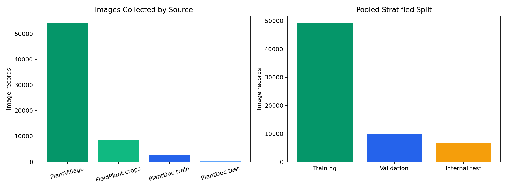
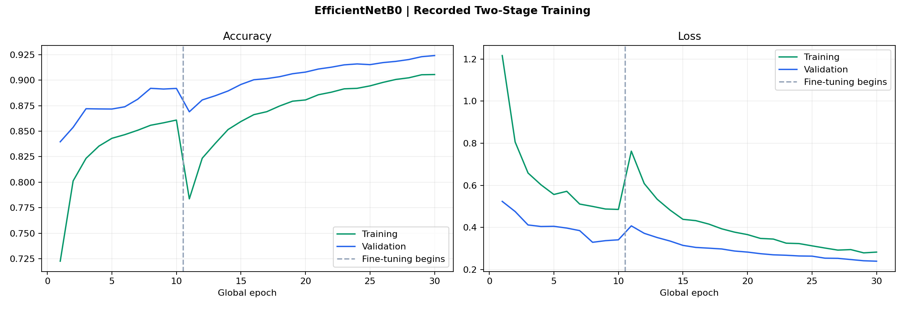
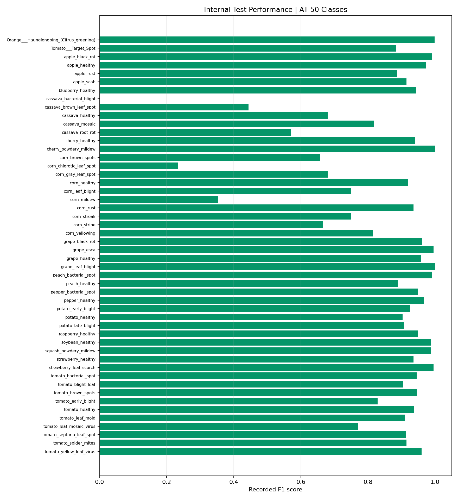
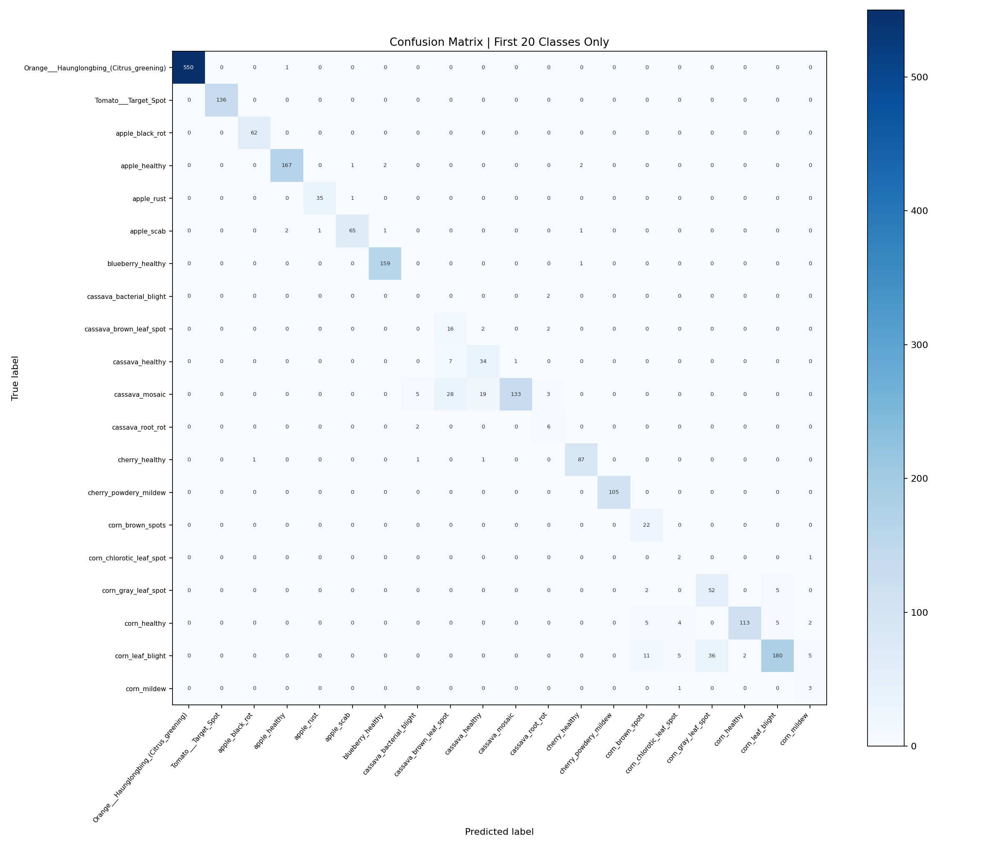

# Plant Disease Camera AI

### Leaf-based plant identification and disease prediction with EfficientNetB0

**Mehmet Mikail Karaman**

I trained a deep learning model for an application that lets a user point a camera at a plant leaf and receive a predicted **plant type** and **disease or healthy condition**. The model learns a joint plant–condition label from leaf appearance, using training data pooled from **PlantVillage**, **FieldPlant**, and **PlantDoc**.

This repository presents the model development behind the application: dataset preparation, label harmonization, two-stage transfer learning, recorded evaluation, and TensorFlow Lite export. The camera-based application description reflects the author's project; the supplied artifact contains training code rather than the mobile application source or app screenshots.

| Recorded result | Value |
| --- | ---: |
| Internal test Top-1 accuracy | **92.59%** |
| Internal test Top-3 accuracy | **98.49%** |
| Macro F1 | **0.843** |
| Weighted F1 | **0.929** |
| Output classes | **50** |
| Pooled image records | **65,742** |
| Test image records | **6,575** |

Metrics are from saved notebook outputs, not a new training run or a camera deployment benchmark.

## Application experience

The application uses a captured leaf image to identify one of the supported plant/condition combinations. A label such as `tomato_early_blight` can be displayed as **Tomato, Early blight**, while `apple_healthy` can be displayed as **Apple, Healthy**. Plant identity and condition are decoded from the same classification result; this model does not have separate species and disease prediction heads.


The training configuration includes a confidence threshold of **0.65**. A suggested app policy is to request a clearer image when the highest score is below this value and optionally show the top three candidate labels. Threshold enforcement is an integration recommendation: the supplied training notebook does not implement a mobile rejection screen or demonstrate score calibration. A softmax score should not be presented as a calibrated probability of disease.

## Model and design rationale

The notebook uses **EfficientNetB0 with ImageNet weights** and a custom 50-class classification head. Transfer learning reuses pretrained visual features and then adapts them to leaf appearance. B0 provides a relatively compact starting point for a mobile-oriented export, and the 224 × 224 input keeps the image-processing interface straightforward.

These are engineering reasons supporting this architecture choice, not claims that the notebook benchmarked EfficientNetB0 against other backbones. No on-device latency, battery use, memory usage, or alternative-model comparison was supplied. See the [official Keras EfficientNet documentation](https://keras.io/api/applications/efficientnet/efficientnet_models/) and the [original EfficientNet paper](https://proceedings.mlr.press/v97/tan19a.html).

```text
RGB image: 224 x 224 x 3
  -> EfficientNetB0 (ImageNet, include_top=False)
  -> GlobalAveragePooling2D
  -> BatchNormalization
  -> Dropout(0.3)
  -> Dense(256, ReLU)
  -> BatchNormalization
  -> Dropout(0.2)
  -> Dense(50, Softmax)
```

## Dataset preparation

The following are counts from this experiment's mounted dataset copies; they are not asserted to be the canonical sizes of the original datasets.

| Source | Collected image records | Labels within source after mapping |
| --- | ---: | ---: |
| PlantVillage, color images | 54,305 | 38 |
| FieldPlant, retained classification crops | 8,515 | 20 |
| PlantDoc, supplied train directory | 2,670 | 28 |
| PlantDoc, supplied test directory | 252 | 27 |
| **Pooled training collection** | **65,742** | **50 distinct combined labels** |

PlantVillage supplies leaf images, while field-oriented sources add varied backgrounds and capture conditions. Combining them is intended to increase visual variety; this experiment does not isolate each dataset's contribution to camera performance.

### From FieldPlant boxes to classification crops

The annotation inspection records **5,156 unique source images**, **8,580 bounding-box annotations**, and **27 source classes**. I converted these annotations into class-folder images by adding **5% padding**, clipping boxes to image boundaries, converting to RGB, and saving JPEG crops at quality 95. Boxes smaller than **20 pixels** in either dimension were skipped.

The conversion saved **8,579 crops**, skipped one small box, and recorded no missing-image or conversion errors. The later class filter retained **8,515 crops**. The crop conversion is a preparation step for image classification; it does not make the final model an object detector.

### Shared labels and split

I mapped source-specific labels into shared identifiers, such as the PlantVillage and FieldPlant corn blight names becoming `corn_leaf_blight`. Selected rare classes were excluded. The model covers supported plant/condition labels including apple, cassava, corn, grape, potato, pepper, tomato, and other crops; it is not an unrestricted plant identification system.

| Internal partition | Image records | Approximate share |
| --- | ---: | ---: |
| Training | 49,305 | 75% |
| Validation | 9,862 | 15% |
| Test | 6,575 | 10% |

Both split operations are stratified with `random_state=42`. Both supplied PlantDoc partitions were pooled before this new split, so the result is **not the original PlantDoc held-out benchmark**.



## Training workflow

Prepare data and labels: inspect dataset layouts, convert FieldPlant boxes to crops, harmonize labels, and build the pooled image table. Augment training images: rotate up to 30 degrees, shift horizontally/vertically by 0.15, apply shear 0.15, zoom 0.20, horizontal flips, and brightness changes from 0.7 to 1.3. Validation and test generators do not use these random augmentations.

Balance the training loss: compute balanced class weights from training labels, without oversampling. Train the head: freeze the pretrained backbone and train for **10 epochs**, using Adam at **1e-3**.

Fine-tune upper layers: mark the backbone trainable, freeze all but its last **30 layers**, recompile with Adam at **1e-5**, and train for **20 more epochs**. Select and evaluate the checkpoint: monitor validation accuracy, reload `best_model.h5`, and evaluate the internal test split.

Export for integration: convert to TensorFlow Lite and save labels/configuration for the app.

The loss is categorical cross-entropy, batch size is **32**, and metrics include accuracy and Top-3 accuracy. Both stages use early stopping, learning-rate reduction, and checkpoint callbacks. The recorded environment reports **TensorFlow 2.20.0** and an NVIDIA Tesla P100 GPU.



The curves are regenerated from saved epoch logs, rounded to four decimals. Their values are available in `training_history.csv`. The final fine-tuning epoch records validation accuracy **0.9241** and validation Top-3 accuracy **0.9837**.

## Results beyond overall accuracy

Overall accuracy alone hides large differences between classes. The saved report shows macro F1 **0.843**, below the weighted F1 of **0.929**. For example, `cassava_bacterial_blight` has F1 **0.000** on only two test samples, and `corn_chlorotic_leaf_spot` has F1 **0.235** on three samples. These small-support classes need more data and more stable evaluation.



The full per-class precision, recall, F1, and support values are stored in `per_class_metrics.csv`. Top-3 accuracy measures whether the correct class appears among three ranked predictions; it does not mean the first prediction is correct 98.49% of the time.

### Partial confusion matrix



The original notebook displays only the **first 20 rows and columns** of a 50-class confusion matrix. The English chart above was reconstructed from the visible counts in that saved figure and checked against it; `partial_confusion_matrix.csv` records the transcribed values. Predictions involving the other 30 classes are outside this block, so its row sums need not equal each class's full test support. This is not the complete confusion matrix.

## Mobile integration and TensorFlow Lite

The notebook records successful export of `plant_disease_model.tflite`, `labels.json`, and `training_config.json`. The trained model binaries and original exported JSON files were not supplied; they are not included here. `labels.json` in this repository reconstructs the output order from the sorted class names and saved classification report and should be checked against the original export before deployment.

For this Keras EfficientNet model:

Convert the image to **RGB** and resize it to **224 × 224**. Supply a batch with shape **[1, 224, 224, 3]**, using **float32 RGB values in [0, 255]**.

Do not additionally divide by 255 or normalize to [-1, 1]; the Keras model includes its own input rescaling. This convention is confirmed by [Keras](https://keras.io/api/applications/efficientnet/efficientnet_models/). Read the 50 output scores using the exact export label order and decode the plant/condition label for display.

The converter uses `Optimize.DEFAULT` and representative validation images. Its saved log reports float32 input and output. It is therefore not described here as a fully integer INT8 model. TFLite accuracy and device performance were not evaluated in the supplied notebook.

## Files and reproduction

| File | Description |
| --- | --- |
| `plant_disease_training.ipynb` | English notebook with the complete training/export workflow and explanatory sections |
| `train_and_export.py` | English Python export of the same workflow |
| `recorded_outputs.txt` | All supplied textual cell outputs translated into English, with ANSI codes removed |
| `training_history.csv` | Recorded metrics for 10 head-training and 20 fine-tuning epochs |
| `per_class_metrics.csv` | Saved test precision, recall, F1, and support for all 50 classes |
| `partial_confusion_matrix.csv` | Visible first-20-class matrix values transcribed from the saved figure |
| `labels.json` | Reconstructed class-index mapping for inspection |
| `experiment_summary.json` | Recorded model, split, input, and metric summary |
| `*.png` | English training, dataset, per-class, and confusion-matrix figures |
| `requirements.txt` | Dependencies, including the recorded TensorFlow version |

```bash
python -m venv .venv
source .venv/bin/activate
pip install -r requirements.txt
jupyter lab plant_disease_training.ipynb
```

Use an environment supported by TensorFlow 2.20.0, preferably with a GPU for training. Add the three dataset copies to Kaggle or update the dataset paths and output directories for another environment. Run cells in order, starting with annotation conversion. The Python script performs the same full workflow and requires those paths to exist.

The notebook's inline outputs were cleared to remove untranslated figures; the translated output transcript and English charts preserve the supplied experimental evidence separately. No training, dataset processing, or model conversion was rerun for this publication.

## Evaluation limits and next experiments

Group related crops before splitting: multiple FieldPlant crops can come from the same source image, while this experiment splits crop/image records. Related images could therefore cross partitions. Rebuild the split using source-image groups and check duplicate/near-duplicate files across datasets. Test camera generalization independently: the 92.59% result belongs to a pooled internal split, dominated by PlantVillage records. It is not evidence of equal performance on new camera images or on each source separately.

Review the label taxonomy: unmatched source names are retained as-is; two labels remain in their original PlantVillage naming style. Some mapped categories may differ in meaning. Verify label equivalence and healthy-class assumptions before deployment. Review fine-tuning behavior: the backbone call is built with `training=False` in stage 1 and reused in stage 2. This retains inference behavior for training-sensitive layers; review BatchNormalization/dropout behavior in further experiments rather than claiming all backbone behavior changes in stage 2.

Validate application thresholds: 0.65 is configured but not selected through a recorded calibration or rejection analysis. Unsupported plants, poor framing, and multiple leaves need their own app-level handling. Measure the exported model: compare Keras and TFLite predictions and benchmark latency, model size, and memory on target devices before making deployment-performance claims.

## Dataset sources and references

The dataset copies mounted in the experiment are:

[PlantVillage Dataset on Kaggle](https://www.kaggle.com/datasets/abdallahalidev/plantvillage-dataset); [PlantVillage source repository](https://github.com/spMohanty/PlantVillage-Dataset). [FieldPlant on Kaggle](https://www.kaggle.com/datasets/bloox2/fieldplant); Moupojou et al., *FieldPlant: A Dataset of Field Plant Images for Plant Disease Detection and Classification With Deep Learning* (2023), [DOI: 10.1109/ACCESS.2023.3263042](https://doi.org/10.1109/ACCESS.2023.3263042).

[PlantDoc dataset copy on Kaggle](https://www.kaggle.com/datasets/nirmalsankalana/plantdoc-dataset); Singh et al., *PlantDoc: A Dataset for Visual Plant Disease Detection* (2020), [original repository](https://github.com/pratikkayal/PlantDoc-Dataset), [DOI: 10.1145/3371158.3371196](https://doi.org/10.1145/3371158.3371196).

Dataset terms belong to their respective providers. Raw dataset images are not redistributed in this repository. The early inspection cell accidentally points its PlantDoc entry at FieldPlant; the training configuration uses the separate PlantDoc train/test directories shown above.

**Focus:** computer vision · plant disease classification · transfer learning · multi-dataset preparation · mobile model integration
